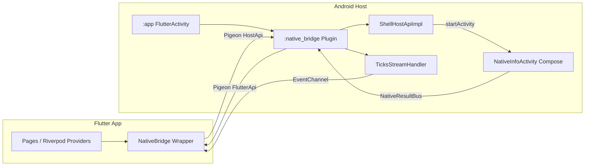
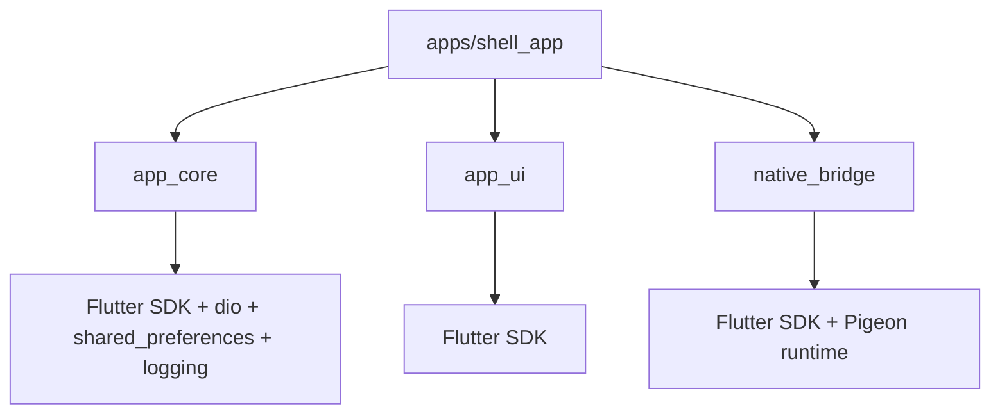
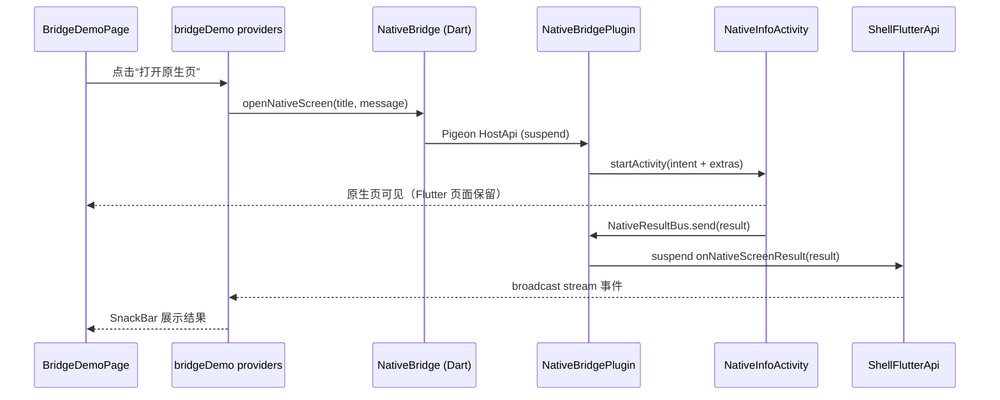

# 01 · 架构设计

> 决策来源：`00-overview.md`。桥接接口细节：`02-bridge-contract.md`。  
> 本文描述**目标架构**，实现状态以 `04-acceptance.md` 与 `docs/evidence/` 为准。

## 1. 设计原则

1. **契约先行**：桥接接口只写在 Pigeon IDL 中，Dart/Kotlin/Swift 生成物同批生成、同批提交。
2. **边界可执行**：包依赖规则与 feature 边界不靠口头约定，由 `tool/check_imports.sh` + CI 校验。
3. **壳不带业务**：v0 只沉淀基础设施与演示链路；业务出现时按扩展手册增量加入。
4. **依赖单向**：app → 共享包；共享包之间低耦合；任何包不得反向依赖 app。
5. **生命周期显式**：Riverpod autoDispose 管理流/请求；插件用 `ActivityAware` 管理 Activity；事件通道 `onListen/onCancel` 成对。
6. **性能默认正确**：首帧前不做桥接调用；不在 `build()` 中发请求；大报文与 IO 明确线程策略。
7. **可验证**：每个结论对应一条命令或一张截图，记录在 `docs/evidence/`。

## 2. 系统上下文



通信全部走 Flutter platform channels（Pigeon 生成），v0 不引入 FFI、不引入 Pigeon Native Interop。

## 3. 仓库结构

```text
flutter-shell/
├── .fvmrc                          # {"flutter":"3.47.9"}，提交
├── .editorconfig
├── .gitignore
├── analysis_options.yaml           # 根级 lint，very_good_analysis 11
├── pubspec.yaml                    # pub workspace 根（不发布）
├── pubspec.lock                    # 提交，锁定全部依赖
├── README.md
├── AGENTS.md                       # 开发规范（唯一）
├── docs/
│   ├── 00-overview.md
│   ├── 01-architecture.md
│   ├── 02-bridge-contract.md
│   ├── 03-implementation-plan.md
│   ├── 04-acceptance.md
│   └── evidence/                   # 各阶段真实命令输出与截图路径
├── tool/                           # 所有可重复执行脚本
│   ├── bootstrap.sh
│   ├── gen.sh
│   ├── check.sh
│   ├── check_imports.sh
│   ├── test.sh
│   ├── test_native_android.sh
│   ├── build_android.sh
│   ├── run_android.sh
│   └── e2e_android.sh
├── .github/workflows/ci.yml
├── apps/
│   └── shell_app/                  # Flutter 宿主（applicationId com.dk.fluttershell）
│       ├── pubspec.yaml
│       ├── l10n.yaml
│       ├── lib/
│       │   ├── main.dart           # 仅调用 bootstrap()
│       │   ├── bootstrap.dart      # 组合根：env/logger/bridge + ProviderScope 覆盖
│       │   ├── app.dart            # MaterialApp.router、主题、i18n
│       │   ├── core/
│       │   │   ├── config/config_providers.dart
│       │   │   ├── logging/log_providers.dart
│       │   │   ├── error/error_handlers.dart
│       │   │   ├── bridge/bridge_providers.dart
│       │   │   ├── router/app_router.dart
│       │   │   ├── network/network_providers.dart
│       │   │   └── storage/storage_providers.dart
│       │   ├── features/
│       │   │   ├── home/presentation/home_page.dart
│       │   │   └── bridge_demo/
│       │   │       ├── application/bridge_demo_providers.dart
│       │   │       └── presentation/bridge_demo_page.dart
│       │   └── l10n/{app_en.arb, app_zh.arb, generated/}
│       ├── test/widget/home_page_test.dart
│       ├── integration_test/bridge_e2e_test.dart
│       ├── android/                # :app，Flutter template + Compose 插件声明
│       └── ios/                    # 脚手架保留，本轮不验收
├── packages/
│   ├── app_core/
│   │   └── lib/
│   │       ├── app_core.dart
│   │       └── src/
│   │           ├── config/app_env.dart
│   │           ├── error/app_failure.dart
│   │           ├── logging/app_logger.dart
│   │           ├── network/{api_client.dart, dio_api_client.dart}
│   │           └── storage/{key_value_store.dart, shared_preferences_key_value_store.dart}
│   ├── app_ui/
│   │   └── lib/
│   │       ├── app_ui.dart
│   │       └── src/
│   │           ├── theme/{app_theme.dart, app_tokens.dart}
│   │           └── widgets/{app_primary_button.dart, app_section_card.dart}
│   └── native_bridge/              # Flutter Plugin，Android 侧是 :native_bridge 模块
│       ├── pubspec.yaml
│       ├── pigeons/shell_api.dart  # 桥接契约唯一来源
│       ├── lib/
│       │   ├── native_bridge.dart  # 对外只导出 wrapper 与数据类型
│       │   └── src/
│       │       ├── shell_bridge.dart
│       │       ├── bridge_exception.dart
│       │       └── generated/shell_api.g.dart
│       ├── android/
│       │   ├── build.gradle.kts
│       │   ├── src/main/AndroidManifest.xml
│       │   ├── src/main/kotlin/com/dk/fluttershell/bridge/
│       │   │   ├── NativeBridgePlugin.kt
│       │   │   ├── ShellHostApiImpl.kt
│       │   │   ├── TicksStreamHandlerImpl.kt
│       │   │   ├── NativeResultBus.kt
│       │   │   ├── NativeResultDispatcher.kt
│       │   │   ├── NativeInfoActivity.kt
│       │   │   ├── SystemInfoMapper.kt
│       │   │   └── generated/ShellApi.g.kt
│       │   ├── src/main/res/values/themes.xml
│       │   └── src/test/kotlin/com/dk/fluttershell/bridge/SystemInfoMapperTest.kt
│       └── ios/
│           └── <iOS 源码目录>/{NativeBridgePlugin.swift, Generated/ShellApi.g.swift}
```

说明：

- `apps/shell_app/android` 下**没有**手写的 `nativebridge` 目录；`:native_bridge` 由 Flutter Plugin 机制自动纳入 Gradle。这是 DEC-003 的实现形态。
- 生成物路径固定，CI 会对它们做「重新生成后无 diff」检查。
- 测试目录按包存在；没有测试的包允许没有 `test/`，但不能空跑后声称已测试。

## 4. 依赖规则（强制）



| 规则 | 内容 | 校验 |
| --- | --- | --- |
| R1 | `packages/**` 不得出现 `package:fluttershell/` | `tool/check_imports.sh` |
| R2 | `packages/**` 不得依赖 Riverpod（`flutter_riverpod` / `riverpod` / 生成器） | `tool/check_imports.sh` |
| R3 | `apps/shell_app/lib/core/**` 不得导入 `features/**` | `tool/check_imports.sh` |
| R4 | 一个 feature 不得导入另一个 feature 的源码 | `tool/check_imports.sh` |
| R5 | `app_ui` 只依赖 Flutter；不得出现业务文案、路由、网络、存储 | 代码评审 + import 检查（R1/R2 间接覆盖） |
| R6 | `native_bridge` 不得依赖 `app_core` / `app_ui` / Riverpod；错误类型自定义 | R1/R2 |
| R7 | `apps/shell_app` 是唯一组合根；依赖注入只在 `bootstrap.dart` 覆盖 | 代码评审 |
| R8 | 新包/新 Gradle 模块必须先更新 `00` 决策表与本节 | 代码评审 |

**feature 内部分层**（按需出现，不强制每层都有文件）：

```text
features/<name>/
├── presentation/   # Widget、页面；只读本 feature 的 application provider
├── application/    # Riverpod provider/controller；编排用例、调用 bridge/core
├── domain/         # 纯 Dart 实体/用例；不依赖 Flutter（有业务后再加）
└── data/           # Repository 实现；依赖 app_core 的接口（有业务后再加）
```

约束：

- `presentation` 不得直接调用 `NativeBridge`、`Dio`、`SharedPreferences`；必须经过 provider。
- `application` 不得导入其他 feature。
- 共享逻辑先在 feature 内实现；第二个消费者出现时，按第 18 节提升为包，不提前抽象。

## 5. 状态管理与依赖注入

- **Riverpod 3.4.3 + riverpod_generator 4.0.9**，全部 provider 使用 `@riverpod` 注解生成。
- 默认 autoDispose；只有真正全局、与 App 同生命周期的服务使用 `@Riverpod(keepAlive: true)`，并在代码注释说明原因。
- 组合根注入（`apps/shell_app/lib/bootstrap.dart`）：
  - `appEnvProvider.overrideWithValue(env)`
  - `appLoggerProvider.overrideWithValue(logger)`
  - `nativeBridgeProvider.overrideWithValue(bridge)`
  - 网络/存储 provider 由 app 层构造，依赖 `appEnvProvider`。
- provider 默认实现抛 `StateError('Override in bootstrap')`，防止漏接线后静默使用错误依赖。
- Widget 规则：
  - 使用 `ConsumerWidget` / `ConsumerStatefulWidget`；
  - `ref.listen` 处理副作用（SnackBar、导航），不在 `build` 中发请求；
  - `AsyncValue` 必须处理 `data/loading/error` 三态；
  - ticker 这类高频更新用独立 `Consumer` 包裹，避免整页重建。
- 不使用 service locator、不使用全局可变单例；原生侧唯一单例 `NativeResultBus` 见第 12 节，限制为单引擎。

## 6. 路由

- `go_router 18.1.2`，所有路由在 `core/router/app_router.dart` 注册。
- 路径常量集中在 `AppRoutes`：`/`（Home）、`/bridge`（Bridge Demo），后续按 `<feature>` 增加。
- `MaterialApp.router` 使用 `routerConfig`；`errorBuilder` 显示本地化错误页。
- v0 不做深链、不做路由守卫；业务出现后按 runbook 增加。
- 路由 provider 使用 `@riverpod`，便于测试覆盖。

## 7. 设计系统与主题

- `app_ui` 提供：
  - `AppSpacing`（4/8/16/24/32）、`AppRadius`（8/12/20）；
  - `AppTheme.light()` / `AppTheme.dark()`，Material 3，`ColorScheme.fromSeed`；
  - `AppPrimaryButton`、`AppSectionCard` 两个基础组件。
- 主题跟随系统（`ThemeMode.system`）；v0 不提供主题切换 UI。
- `app_ui` 不包含业务文案、不读取 Riverpod、不做网络/存储。
- 可访问性要求：点击目标 ≥ 48dp，文本对比度符合 Material 3 默认语义色，交互控件带 `Semantics` 或可读 label。

## 8. 国际化

- `flutter gen-l10n`，ARB 位于 `apps/shell_app/lib/l10n/`，模板 `app_en.arb`，同时维护 `app_zh.arb`。
- `l10n.yaml` 指定 `output-dir: lib/l10n/generated`、`nullable-getter: false`；生成物提交，禁止手改。
- 所有 Flutter 用户可见文案必须走 `AppLocalizations`；调试日志不受此限。
- 原生演示页资源串只提供英文（`values/strings.xml`），本轮不要求原生页本地化；新增真实原生 UI 时再补 `values-zh-rCN`。
- 新增语言：添加 ARB + 确认 `supportedLocales` + 更新本条（见第 18 节）。

## 9. 配置、日志与错误

### 9.1 环境配置

- `AppEnv { dev, prod }`，来自 `const String.fromEnvironment('APP_ENV', defaultValue: 'dev')`。
- 非法值立即抛 `ArgumentError`，不允许静默回落。
- release 构建脚本强制注入 `--dart-define=APP_ENV=prod`；prod 下不允许出现 debug 级日志。
- v0 不建 Android product flavor；多渠道/多包名需求出现时单独决策。

### 9.2 日志

- 使用 `logging 1.3.0`，封装为 `AppLogger`；按 tag 创建子 logger。
- 级别：dev = ALL，prod = INFO；输出带时间、级别、tag。
- 禁止 `print` / `debugPrint` 进入提交（调试时可临时使用，提交前删除）。
- 禁止记录 Token、手机号、精确位置等 PII；桥接错误记录 code 与截断后的 message。
- v0 只接控制台 sink；后续接 Crash/日志平台时只改 sink，不改调用点。

### 9.3 错误模型

`app_core` 定义 sealed `AppFailure`：

```dart
sealed class AppFailure implements Exception {
  const AppFailure(this.message, {this.cause});
  final String message;
  final Object? cause;
}
final class NetworkFailure extends AppFailure { ... }
final class StorageFailure extends AppFailure { ... }
final class UnexpectedFailure extends AppFailure { ... }
```

- `native_bridge` 自定义 `BridgeException(code, message, details)`，不依赖 `app_core`。
- app 层需要统一展示时，将 `BridgeException` 映射为 `UnexpectedFailure`（保留 code 到 message），映射表见 `02` 第 6 节。
- 全局兜底（`bootstrap.dart`）：
  - `FlutterError.onError`：记录后交给默认处理（debug 保留红屏）；
  - `PlatformDispatcher.instance.onError`：记录并返回 `true`；
  - `ErrorWidget.builder`：release 下显示本地化错误占位，不泄露堆栈。

## 10. 网络与存储抽象

- `ApiClient` 接口：`Future<Map<String, Object?>> getJson(Uri uri, {Map<String, String>? headers})`。
- `DioApiClient`：connect/receive timeout 10s；非 2xx 抛 `NetworkFailure`；`DioException` 统一映射；不启用明文 HTTP。
- `KeyValueStore` 接口：`read/write/delete`；实现 `SharedPreferencesKeyValueStore`；key 统一加 `app.` 前缀。
- v0 不进行任何业务调用；但必须有测试（Dio 假 adapter、`SharedPreferences.setMockInitialValues`）证明可用，不能是空实现。
- 业务接入时在 feature 的 `data/` 下实现 Repository，调用 `app_core` 接口；不得在 widget 中直接使用 Dio/SharedPreferences。

## 11. Android 工程

- **`:app`**：Flutter 模板生成，`MainActivity` 不写桥接注册逻辑；`GeneratedPluginRegistrant` 自动注册 `NativeBridgePlugin`。
- **`:native_bridge`**：`packages/native_bridge/android` 是独立 Android Library 子项目，由 Flutter Gradle 插件自动 include；模块名以 `./gradlew projects` 输出为准（预期 `:native_bridge`）。
- 插件 Android namespace：`com.dk.fluttershell.bridge`；插件类：`NativeBridgePlugin`。
- `NativeBridgePlugin` 实现 `FlutterPlugin` + `ActivityAware`：
  - `onAttachedToEngine`：注册 HostApi、注册 EventChannel handler、创建 FlutterApi 代理与 `NativeResultBus`；
  - `onAttachedToActivity` / `onDetachedFromActivity`：维护 `Activity?` 引用；
  - `onDetachedFromEngine`：注销 HostApi、关闭事件流、清空 `NativeResultBus`。
- 原生演示页 `NativeInfoActivity` 用 Jetpack Compose；`exported=false`；在插件 manifest 中声明，靠 manifest merger 进入 app。
- SDK/Java：compileSdk 36、targetSdk 36、minSdk 24、Java 17；Flutter 3.47.9 模板为 AGP 9.1.0 / Kotlin 2.4.0，Gradle 以模板 wrapper 为准。
- Release：R8/resource shrinking 按 Flutter 默认；v0 release 使用 debug 签名，仅用于构建验证，不可发布。

## 12. Native Bridge 架构

### 12.1 契约与生成管线

```text
pigeons/shell_api.dart  ──dart run pigeon──▶  Dart 生成物 (.g.dart)
                                              Kotlin 生成物 (.g.kt)
                                              Swift 生成物 (.g.swift)
```

- 生成命令统一由 `tool/gen.sh` 调用，不接受手敲参数。
- 同一提交内三端生成物必须来自同一 Pigeon 版本；生成物提交，CI 检查无漂移。
- Pigeon 生成代码不进入公开 API：`lib/native_bridge.dart` 只导出 `NativeBridge`、`BridgeException`、`SystemInfo`、`NativeScreenResult`。

### 12.2 线程模型

| 通道 | 生成形态 | 执行线程 | 规则 |
| --- | --- | --- | --- |
| `getSystemInfo`（`@async`） | Kotlin `suspend` | 主线程进入，IO 切到 `Dispatchers.IO` | PackageManager 查询不得占用主线程 |
| `openNativeScreen`（`@async`） | Kotlin `suspend` | 主线程 | `startActivity` 必须在主线程；无 Activity 抛 `NO_ACTIVITY` |
| `ticks`（`@EventChannelApi`） | Kotlin `TicksStreamHandler` + `PigeonEventSink<Long>` | 主线程协程 | `onListen` 启动、`onCancel` 取消；取消后不得再发 |
| `onNativeScreenResult`（`@FlutterApi`） | Kotlin `suspend` 代理 | 主线程协程（插件内 App 级 scope） | 原生页 finish 前触发；失败只记录日志，不崩溃 |

### 12.3 生命周期

- 事件流由 Riverpod autoDispose 的 `StreamProvider` 消费；页面销毁 → 取消订阅 → Pigeon `onCancel` → 原生协程取消。
- 插件 `onDetachedFromEngine` 必须清理 HostApi 注册、事件 handler、`NativeResultBus` 与协程 scope。
- 原生页回传通过 `NativeResultBus`（进程级、单引擎假设）：
  - 插件在 attach 时安装 dispatcher；
  - Activity 点击确认/取消或返回键时调用 `NativeResultBus.send(result)`；
  - dispatcher 在 `Dispatchers.Main.immediate` 上调用生成的 `ShellFlutterApi`（`suspend`），Dart 侧 `ShellFlutterApi.setUp` 的处理器写入 broadcast stream；
  - Flutter engine 已 detach / dispatcher 未安装时回传被丢弃并记录 `RESULT_DROPPED`；Dart 侧无订阅时 broadcast 直接丢弃事件（不额外记录）。
- 多引擎/多 Flutter 实例不是 v0 目标；引入时必须把 `NativeResultBus` 改为按 engine 注册。

### 12.4 原生页往返时序



## 13. iOS 工程（本轮仅结构）

- `apps/shell_app/ios` 与 `packages/native_bridge/ios` 保留。
- Pigeon 生成 `ShellApi.g.swift`；`NativeBridgePlugin.swift` 提供最小实现桩：
  - HostApi 方法抛 `PigeonError(code: "UNIMPLEMENTED", ...)`；
  - 事件流注册一个立即报错的 handler；
  - FlutterApi 代理不需要在桩阶段调用。
- Podspec 的 `source_files` 必须覆盖 `Classes/**/*`，包含 `Generated/`。
- **本轮不执行 `pod install`、不编译、不运行、不进 CI**；`04-acceptance.md` 只做文件存在性检查。任何“iOS 可用”的表述都属于不合格交付。

## 14. 性能策略

### 14.1 启动

- `main()` 只调用 `bootstrap()`；首帧前不发起任何桥接调用。
- `NativeBridge` 构造只创建 wrapper，不在构造中 `getSystemInfo`。
- 存储/网络延迟初始化；v0 不阻塞启动。
- 记录冷启动：`adb shell am start -W -n com.dk.fluttershell/.MainActivity`，取 3 次 TotalTime，写入 evidence（不设硬阈值）。

### 14.2 渲染与重建

- 高频流（ticker）只在独立 `Consumer` 中 watch，不放在页面根部。
- 所有可静态化的 Widget 使用 `const`。
- 列表使用 builder 构造；v0 无长列表，规则为后续预留。
- 不在 `build()` 中做 IO、JSON 解析、日志字符串拼接。
- 桥接返回的对象只做展示，不在 build 中反复请求。

### 14.3 桥接与大报文

- 默认 platform channels；适合低频、小报文（v0 全部满足）。
- 规则：单次报文 > 256KB、或原生处理可能 > 5ms，必须放原生后台线程，并用 `Uint8List`/流式分片；禁止主线程大 JSON 序列化。
- 事件流频率默认 ≤ 10Hz；ticker 为 1Hz。
- 需要高频/二进制密集场景时，另立决策评估 FFI 或 Native Interop，不在 v0 引入。

### 14.4 Release 构建

```bash
cd apps/shell_app
flutter build apk --release \
  --split-per-abi \
  --obfuscate \
  --split-debug-info=build/symbols \
  --dart-define=APP_ENV=prod
```

- 记录各 ABI APK 体积到 evidence。
- R8/resource shrinking 保持 Flutter 默认开启；若关闭必须在决策表说明原因。
- 符号文件 `build/symbols` 不进仓库。

## 15. 安全策略

- 不提交 keystore / `key.properties` / `.env`；`android/key.properties` 进 `.gitignore`，提供 `key.properties.example`（P6）。
- v0 release 使用 debug 签名，仅构建验证；正式发布前必须切换正式签名（记录为已知限制）。
- 原生页 `exported=false`；不声明不必要的权限；v0 主 manifest 不添加 `INTERNET`（无真实请求）。
- Android release 禁止明文流量：`android:usesCleartextTraffic="false"`；`allowBackup="false"`（P6 hardening）。
- 日志与错误上报不得包含 Token、账号、精确位置等 PII。
- `--dart-define` 不是秘密存储；不得传 API 密钥。
- 依赖锁定在 `pubspec.lock`；Gradle 依赖版本固定；升级需单独提交并跑完整验收。

## 16. 测试策略

| 层级 | 范围 | 工具 | 运行位置 |
| --- | --- | --- | --- |
| Dart 单元 | `AppEnv` 解析、错误映射、bridge wrapper 的异常映射、Dio 假 adapter、存储 mock | `flutter test` | 本地 + CI |
| Flutter Widget | Home 渲染、Hello 文案、导航入口 | `flutter_test` | 本地 + CI |
| Android 单元 | `SystemInfoMapper` 版本字符串/空值处理 | JUnit4 + `./gradlew testDebugUnitTest` | 本地 + CI |
| 集成（Android） | `getSystemInfo` 真实桥接 + ticker 至少 2 个事件 | `integration_test` + 模拟器 | 本地（CI 可选，默认不跑） |
| 手工验收 | 原生页打开、确认/取消回传、SnackBar | 模拟器 + logcat + 截图 | 本地 |

- 单元测试不得访问真实网络；Dio 使用自定义 `HttpClientAdapter` 假实现，存储使用 `SharedPreferences.setMockInitialValues`。
- 集成测试只覆盖方法 + 事件流；原生页回传因需要人工点击，列为手工验收（可选 adb 辅助）。
- 不以“命令退出码为 0”作为唯一证据；关键断言必须检查输出中的计数/字段（见 `04`）。

## 17. 构建与 CI

- 本地脚本是唯一入口：`tool/*.sh`；CI 调用同一批脚本。
- CI（GitHub Actions，`ubuntu-latest`）：
  1. 读取 `.fvmrc` 解析 Flutter 版本；
  2. `flutter pub get`（workspace 根）；
  3. `bash tool/gen.sh`；
  4. `git status --porcelain` 必须为空（生成物无漂移）；
  5. `bash tool/check.sh`；
  6. `bash tool/test.sh`；
  7. `bash tool/test_native_android.sh`；
  8. `bash tool/build_android.sh --debug`，上传 APK artifact。
- 仓库当前无远程，workflow 未在 GitHub 实际运行；验收时标注为“本地脚本等价验证 + workflow 静态检查”。
- iOS 不进入 CI。

## 18. 扩展手册（必须按此路径增长）

### 18.1 新增 Flutter 页面/feature

1. 建 `features/<name>/presentation` 与 `application`；
2. provider 放 `application`，UI 只读 provider；
3. 路由加到 `AppRoutes` + `app_router.dart`；
4. 文案加到 `app_en.arb` + `app_zh.arb`；
5. 新增 widget 测试；
6. 更新 `04` 验收清单（如有用户可见行为）。

### 18.2 新增桥接 API

1. 只改 `packages/native_bridge/pigeons/shell_api.dart`；
2. `bash tool/gen.sh`；
3. Kotlin 实现（`@async` → `suspend`；事件流 → `XxxStreamHandler`）；
4. Swift 桩同步更新（允许未验证，但必须存在并标注）；
5. Dart wrapper 增加方法 + 错误映射；
6. app 层 provider + UI + 测试；
7. 更新 `02` 契约表与 `04` 验收用例；
8. 同一提交，禁止只改一端。

### 18.3 新增原生能力

- 第二个消费者出现前，能力留在 `native_bridge` 内按文件/包隔离；
- 出现独立复用需求时，新建独立 Flutter Plugin 包（`packages/<capability>`），迁移代码与 IDL；
- 新 Gradle 模块/新包必须在 `00` 决策表登记。

### 18.4 新增语言

- 添加 `app_<locale>.arb`，保持 key 与模板一致；
- `flutter gen-l10n`；
- 检查 `supportedLocales` 自动包含；
- 原生资源仅在真实原生 UI 需要时补。

### 18.5 新增环境变量

- 在 `AppEnv` 增加 `String.fromEnvironment` 字段；
- 补默认值与非法值测试；
- 更新 `tool/build_android.sh` 与 CI 的注入参数；
- 禁止把秘密写入 dart-define。

### 18.6 引入 Android product flavor（未来）

- 需同时改 Gradle、CI、构建脚本、文档与签名策略；
- 先写决策，不在业务 PR 中夹带。

## 19. 已知限制与技术债

1. iOS 仅结构桩，未编译未运行。
2. GitHub Actions 未在远程实际执行（无远程仓库）。
3. `NativeResultBus` 为进程级单例，仅支持单 Flutter engine。
4. 原生演示页与回传属演示资产，接真实原生能力时需替换或迁移。
5. v0 release 使用 debug 签名，不具备发布条件。
6. 性能数字来自模拟器，仅作基线，不代表真机。
7. 网络/存储为占位层，无真实业务验证。
